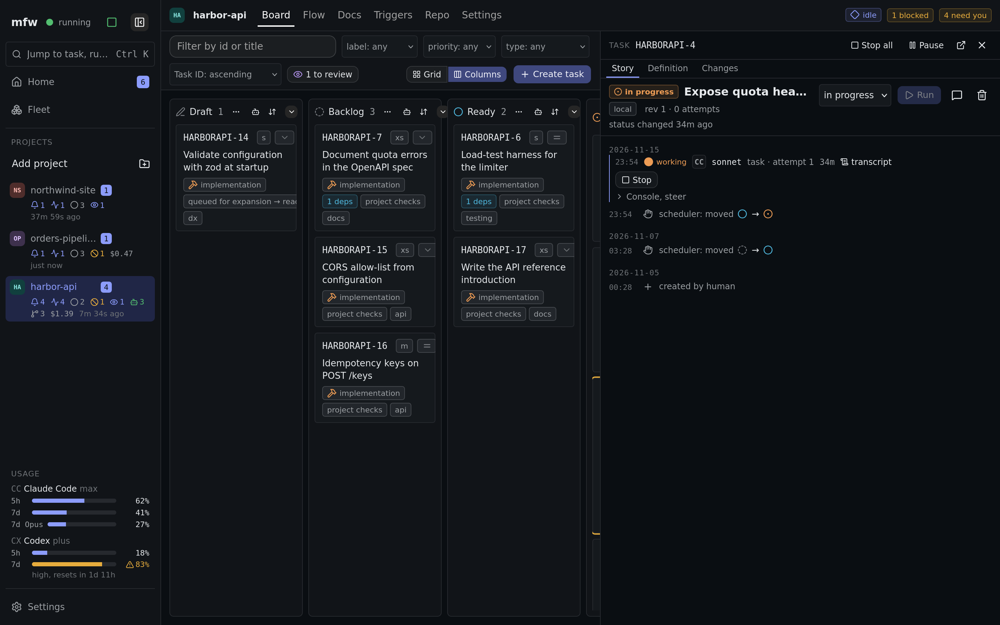
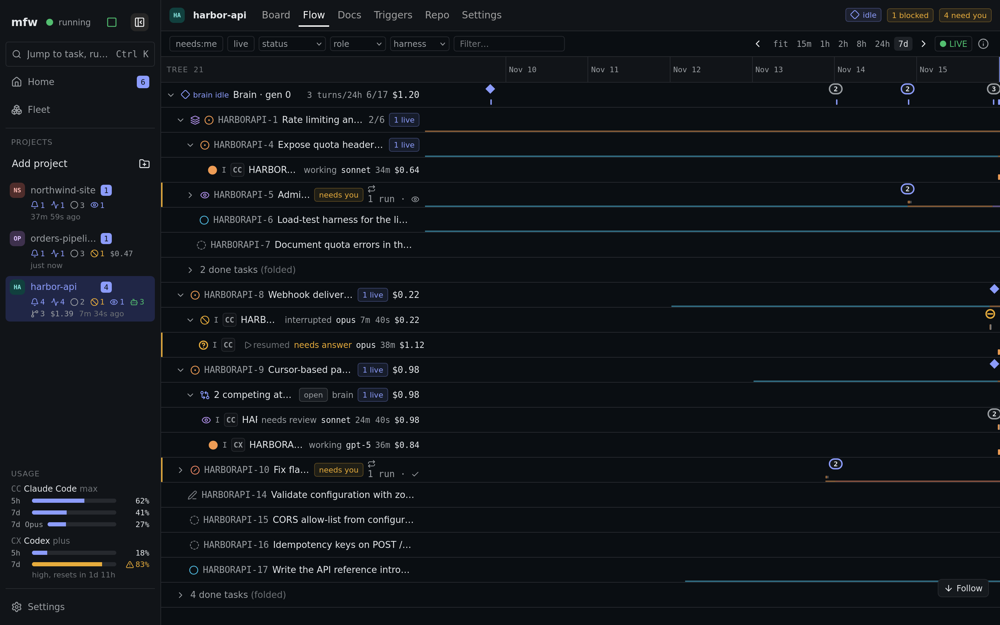
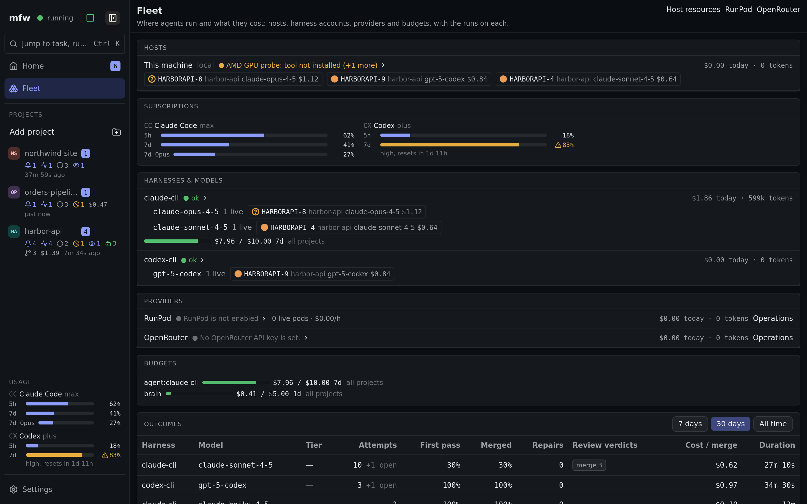
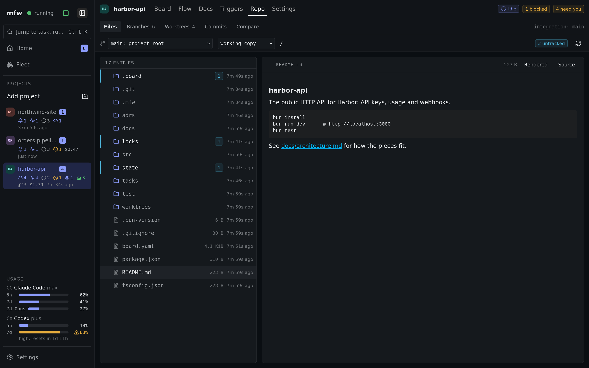
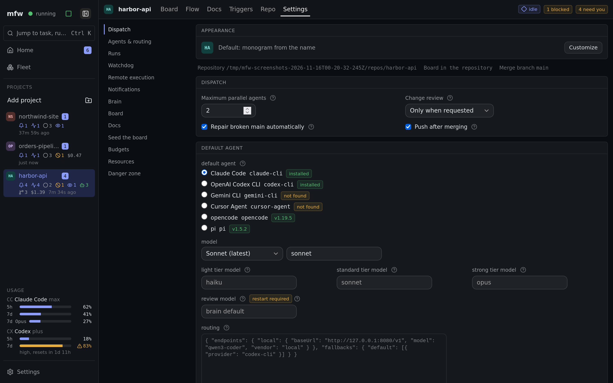

# mfw

**mfw lets AI coding agents work through your project's to-do list while you stay
in control.** You describe the work as tasks. mfw decides what can start, hands
each task to an agent, checks the result, and merges it only if it passes.

> **Pre-release.** mfw runs coding agents on your machine and can merge and push
> their work. Read the [safety summary](#safety-summary) first. Some features are
> [experimental](docs/experimental.md).

mfw is three things that fit together. You can use the first on its own.

| Part | What it is | Use it to |
| --- | --- | --- |
| [**Board tool**](#1-the-board-tool-mfw-board) (`mfw-board`) | A command-line tool for a folder of task files | Keep and query a project's tasks and decisions, see what is ready to work on, plan work that can run in parallel |
| [**Daemon**](#2-the-daemon) | A background engine | Run agents on ready tasks automatically, verify their work and merge it |
| [**Web UI**](#3-the-web-ui) | A website served from your machine | Watch and steer everything: the board, running agents, reviews |

```
  you ──► Web UI ──► Daemon ──► coding agents working in git
              │         │
              └─────────┴──► Board: plain task files in a folder  ◄── mfw-board (CLI)
```


More screenshots [below, in the web UI section](#3-the-web-ui).

## 1. The board tool (`mfw-board`)

A **board** is a folder of plain text files (markdown): one file per task, plus
files for specs and design decisions. There is no database to keep in sync, and
the files live in git like the rest of your project. `mfw-board` (also run as `mfw board`) is the tool for
working with them from the terminal. It needs no server and works on its own.

What you can do with it:

- **Create and update tasks**, with typed fields, checklists and notes. Edits are
  safe when several people or agents change the same file at once.
- **See what is ready:** tasks whose dependencies are all finished.
- **Plan parallel work:** `mfw board plan` picks a batch of ready tasks that will not
  step on each other's files. `mfw board graph` draws the dependency graph.
- **Move tasks along** with the steps your board defines (`start`, `done`, ...),
  optionally committing just that task's file.
- **Validate** the whole board: broken links, duplicate ids, dependency cycles.

```sh
mfw board list status=planned           # find tasks
mfw board ready                         # what can start now
mfw board plan --max 4                  # a batch that will not collide
mfw board start ABC-12                  # begin a task
mfw board done ABC-12 "landed"          # finish it
```

How a board looks (which fields exist, how ids are numbered, which steps are
allowed) is defined in one `board.yaml` file, so the same tool fits very
different projects. Every command is explained in
[packages/board/README.md](packages/board/README.md). `mfw board skill install` also
teaches your coding agents (Claude Code, Codex, opencode, pi) how to use it.

## 2. The daemon

The daemon is the engine that does the work. For each project you attach, it:

- **Picks ready tasks** in dependency order, and runs several at once.
- **Gives each task its own private clone of the repository**, so agents never
  overwrite each other or touch your checkout.
- **Runs a coding agent** on the task, in a sandbox: Claude Code or OpenAI Codex
  CLI. Agents that speak the [Agent Client Protocol](https://agentclientprotocol.com)
  (ACP), such as Cursor, Gemini CLI, opencode and pi, have no sandbox profile yet
  and run only unsandboxed with interactive approval
  ([experimental](docs/experimental.md#acp-agents)). Each agent runs in its own
  session that survives restarts of the daemon, and you can steer or stop it while
  it works.
- **Checks the result** against the task's goal, then runs the task's `run`
  checks without trusting the agent's word. An autonomous run's checks run on its
  committed tip inside the no-network verifier sandbox. A check that cannot run
  there is reported as an infrastructure result, never retried on the host. Only
  an interactive worktree run's checks run on the host, because a person
  approved the run (see [docs/verifier-sandbox.md](docs/verifier-sandbox.md)).
- **Merges automatically** when everything passes, into a branch you choose, and
  pushes it unless you set `pushOnMerge: false`. A change to files the host later
  executes (agent config, CI, git behaviour, build entry points) waits for your
  approval. If the main branch turns red, it stops merging and can repair it.
- **Asks a model for help only when needed:** to diagnose an ambiguous failure,
  resolve a stubborn conflict, or review a change. Scheduling, checking and
  merging are always mechanical.
- **Handles recurring work and reactions:** tasks that repeat on a schedule or
  event, and triggers such as "deploy after a merge lands".
- **Can use a rented GPU machine (RunPod)** for tasks that need one. This is
  [experimental](docs/experimental.md#remote-targets-ssh-and-runpod) and off by
  default.

### Safety summary

The scheduler is **off** until you turn it on, so starting mfw never starts
spending. With the default `agentIsolation: "bwrap"`:

- **An agent runs in a sandbox.** It sees its private clone, a read-only system
  and a synthetic home. It cannot see your home directory, mfw's state or your
  checkout.
- **An autonomous launch needs proof.** A probe inside the sandbox must pass for
  that exact launch. If it cannot, the run is refused rather than run unsandboxed.
- **Network access is an allowlist.** Each run has its own network namespace and
  reaches only its vendor's hosts, through a per-run proxy
  ([docs/egress.md](docs/egress.md)).
- **The host does not trust results.** It imports work as a validated git bundle,
  runs checks in a no-network sandbox, and asks you before merging changes to
  files it later executes.

What this does **not** stop:

- A run can read its agent CLI's login and send it, or the code it can see, to an
  allowed vendor host, up to an upload budget.
- Code that passes its checks merges and pushes, and runs with your rights when
  you build or run it.
- `agentIsolation: "none"`, ACP agents, armed host triggers and remote targets do
  not have this protection.
- The systemd limits and real agent CLIs have not yet been verified end to end
  under the full sandbox.

[SECURITY.md](SECURITY.md) is the one-page version and explains how to report a
vulnerability. The [threat model](docs/threat-model.md) has every boundary, the
code that enforces it and the known risks.

## 3. The web UI

The web UI runs on your machine and shows:

- **Lead**, each project's landing page: where things stand, what needs you, and a
  box to give the project's brain a one-sentence direction or ask it a question;
- the **board** as a grid of task cards grouped by status (or as columns), with each task's detail, history and files;
- **running agents**, live: a readable view and the raw output, with buttons to
  steer or stop an agent mid-task;
- the **review queue** for work waiting on a human, and an **inbox** of things that
  need your attention;
- **docs**: the project's decisions, specs and journals from the board, plus any
  documentation directories you add (or accept from the suggestions), with
  search, rendered Mermaid diagrams and SVG/PNG images, read-only for plain files;
- **runs**, **resources** and **triggers**, and per-project **settings** such as the
  scheduler switch and how much help the model may give;
- a layout that works on a phone as well as a desktop.

| | |
| --- | --- |
| <a href="docs/screenshots/home-dark-1440x900.png"></a><br>Home: what needs you, and agents live across projects | <a href="docs/screenshots/board-inspector-dark-1440x900.png"></a><br>A task open in the inspector next to the board |
| <a href="docs/screenshots/flow-dark-1440x900.png"></a><br>Flow: the task tree and run timeline, brain on top | <a href="docs/screenshots/fleet-dark-1440x900.png"></a><br>Fleet: hosts, subscriptions, harnesses and budgets |
| <a href="docs/screenshots/brain-dark-1440x900.png"></a><br>The brain: its decisions, plan and budget | <a href="docs/screenshots/docs-dark-1440x900.png"></a><br>Docs: decisions, specs and journals |
| <a href="docs/screenshots/repo-dark-1440x900.png"></a><br>Repo: files with the README rendered, branches, commits | <a href="docs/screenshots/settings-dark-1440x900.png"></a><br>Project settings |

### For agents: the MCP server

`@mfw/mcp` lets a coding agent read and edit your tasks through the running app,
so there is still only one source of truth. Create a token first
([API tokens](#api-tokens)), then add it to any MCP-capable agent:

```json
{ "mcpServers": { "mfw": { "command": "bun", "args": ["run", "packages/cli/src/main.ts", "mcp"] } } }
```

It offers tools to list and read tasks, see the dependency graph, create, edit
and move tasks, check the inbox and health, and look at runs.

## Getting started

### Requirements

| Need | Why |
| --- | --- |
| Linux on x86_64 | the sandbox's seccomp filter is x86_64 only; other platforms cannot run autonomously |
| [Bun](https://bun.sh) | runs mfw |
| [git](https://git-scm.com) and [tmux](https://github.com/tmux/tmux) | repositories and agent sessions |
| [bubblewrap](https://github.com/containers/bubblewrap) (`bwrap`) 0.10 or newer, with unprivileged user namespaces | the agent sandbox |
| a systemd user manager with delegated controllers | per-run memory and task limits; autonomous runs are refused without it |
| Claude Code or Codex CLI | the agents. ACP agents are [experimental](docs/experimental.md#acp-agents) |
| `openssl` (optional) | only for the `smoke:serve-check` rehearsal |

### Quick start

**1. Build and start the server.**

```sh
bun install
bun run build
bun run start
alias mfw="bun run $PWD/packages/cli/src/main.ts"   # in another shell, from the checkout
```

**2. Create the owner account.** Open **http://localhost:7777/mfw/**. On first start
the server writes a one-time setup token to a private file and logs only its path:

```sh
cat "${MFW_HOME:-$HOME/.local/share/mfw}/setup-token"
```

Enter it and choose a password of at least 12 characters. See
[Signing in](#signing-in) for recovery.

**3. Log your agent CLI in to its fleet directory.** Sandboxed agents use a
dedicated login under `$MFW_HOME/agents/`, never your personal one. mfw never reads
or copies it. Use the vendor's own login:

```sh
export MFW_HOME="${MFW_HOME:-$HOME/.local/share/mfw}"
mkdir -p -m 700 "$MFW_HOME/agents/claude" "$MFW_HOME/agents/codex"
CLAUDE_CONFIG_DIR="$MFW_HOME/agents/claude" claude   # then sign in
CODEX_HOME="$MFW_HOME/agents/codex" codex login
```

**4. Add a project, then switch it to a private clone.** Add the project in the UI.
Until the default changes, a sandboxed project **starts no runs** without this
setting, and the inbox tells you so. Add it to the project's entry in
`$MFW_HOME/config.json`, then restart the server:

```json
{ "projects": [{ "name": "my-project", "runWorkspace": "clone" }] }
```

Keep the entry's other fields. A project with an `.envrc` is refused for now,
because dev shells do not run inside the sandbox yet.

**5. Direct the work.** The project opens on **Lead**. Give it a direction or create
a few tasks on the board, then switch the scheduler on. Nothing runs until you do,
and the choice is remembered across restarts.

To use only the board tool, you do not need any of that:

```sh
bun packages/board/src/cli.ts --help
```

### Reach it from your phone

**[Experimental](docs/experimental.md#tailscale-and-proxy-exposure).** Keep the server on loopback and let Tailscale publish it with a real certificate,
through a private socket and on an HTTPS port of its own. Start the server with:

```sh
HOST=127.0.0.1 MFW_LISTEN_SOCKET="$HOME/.local/share/mfw/serve/mfw.sock" \
  MFW_ALLOWED_HOSTS=<machine>.<tailnet>.ts.net:8443 mfw server
```

Then publish it (a socket target needs root):

```sh
sudo tailscale serve --bg --https=8443 unix:$HOME/.local/share/mfw/serve/mfw.sock
```

Open `https://<machine>.<tailnet>.ts.net:8443/mfw/` from any device on your tailnet.
This has not yet been tested against a real `tailscale serve`.

The server refuses to start on a non-loopback address without TLS or a trusted
proxy, and never listens on `0.0.0.0`. [docs/exposure.md](docs/exposure.md) covers
other proxies, why mfw needs its own origin, the threat notes and a manual check.

### Run it as a service

- **systemd (user):** copy [`packaging/mfw-server.service`](./packaging/mfw-server.service) to
  `~/.config/systemd/user/`, then `systemctl --user enable --now mfw-server`.
- **NixOS / home-manager:** import
  [`packaging/mfw.home-manager.nix`](./packaging/mfw.home-manager.nix).

Both keep the scheduler off until you enable it in the UI.

### Settings

| Variable | Default | What it does |
| --- | --- | --- |
| `MFW_HOME` | `~/.local/share/mfw` | where mfw keeps its settings, database and run records |
| `PORT` / `HOST` | `7777` / `127.0.0.1` with `mfw server` or `bun run start` | the address the server listens on; the built server refuses an unset `HOST` |
| `MFW_BASE_PATH` | `/mfw/` | the URL prefix, fixed when you run `bun run build` (`/` for the root) |
| `MFW_URL` | `http://localhost:7777/mfw/api/trpc` | where the MCP server finds the app |
| `MFW_ALLOWED_HOSTS` | none | exact `host` or `host:port` names the UI may be reached on (comma separated, no wildcards); loopback is always allowed |
| `MFW_LISTEN_SOCKET` | none | a private unix socket under `$MFW_HOME` for a TLS proxy; the recommended way to run behind Tailscale Serve |
| `MFW_TRUSTED_PROXIES` | none | proxy peer addresses or CIDRs whose forwarded headers are honoured; loopback is not trusted by default |
| `MFW_EXPERIMENTAL_REMOTE` | off | `1` enables the [experimental](docs/experimental.md#remote-targets-ssh-and-runpod) SSH and RunPod targets, never for autonomous runs |

The main per-project keys in `$MFW_HOME/config.json`:

| Key | Default | What it does |
| --- | --- | --- |
| `agentIsolation` | `bwrap` | the sandbox. `none` needs `approvalMode: "interactive"` and runs agents as your user |
| `approvalMode` | `autonomous` | `interactive` asks a person for agent actions |
| `runWorkspace` | `worktree` | set it to `clone`: sandboxed runs refuse a worktree ([why](docs/experimental.md#clone-workspaces)) |
| `pushOnMerge` | `true` | push the integration branch after each merge |

Agent network access, its per-project settings and its limits are described
in [docs/egress.md](docs/egress.md).

### Signing in

Auth is always on, including on loopback. On first start the server writes a
one-time **setup token** to `$MFW_HOME/setup-token` (readable only by you) and
logs only that path; the token itself never goes to a log. Open the UI, enter
the token and choose the owner password. `mfw auth setup-token` prints a new
one, and a token expires after an hour.

Run these on the host, outside any agent sandbox:

| Command | What it does |
| --- | --- |
| `mfw auth unlock` | clear failed sign-in attempts, if you are locked out |
| `mfw auth sign-out-everywhere` | revoke every session and API token, including stolen ones, and delete every passkey (`--keep-passkeys` keeps them) |
| `mfw auth setup-token` | issue a new first-run token (before an owner exists) |
| `mfw auth token ...` | create, list and revoke API tokens (see below) |
| `mfw auth passkey list` | show registered passkeys: name, created, last used, and the address that added it |
| `mfw auth passkey revoke <id>` | remove a passkey, sign out the sessions it opened and revoke the API tokens they created |
| `mfw auth reset --yes` | forget the password and all sessions, then repeat setup |

Failed sign-ins are limited per address (behind a trusted proxy, per forwarded
client), and all of loopback counts as one address. A sandboxed agent has its own
network namespace and cannot reach the daemon on loopback, so it cannot use up
your limit. An unsandboxed run
(`agentIsolation: "none"`) shares loopback with you and can slow your sign-in;
`mfw auth unlock` clears it.

To change the password, use Settings > Session. It asks for the current password
and signs out every other session. It also deletes every passkey unless you
untick **Revoke all passkeys** and keep the ones you choose.

#### Passkeys

**[Experimental](docs/experimental.md#passkeys)** until reviewed. A passkey is an
extra way for the owner to sign in; the password stays, and `mfw auth reset` is
still the recovery. Add one under Settings > Passkeys: it asks for the password
again first, and nothing else will do, so a stolen session cannot add one. The
login page then offers **Sign in with a passkey**, which opens the same kind of
session as the password.

- Passkeys work on `http://localhost:<port>` and on an HTTPS name listed in
  `MFW_ALLOWED_HOSTS` (directly or through a trusted proxy). They are refused on a
  bare IP address such as `127.0.0.1`, and on plain HTTP anywhere else. A passkey
  belongs to the name it was added on, so one added on `localhost` does not work
  on your tailnet name, and the other way round.
- The device must verify you (PIN, fingerprint or face); a key that only checks
  presence is refused. Attestation is not requested, so any authenticator that
  stores the passkey on the device works. A security key that cannot store one
  (a non-discoverable credential) is refused, and so is a browser that does not
  say whether it stored one (see [experimental.md](docs/experimental.md#passkeys)). Only ES256 and EdDSA keys are
  accepted, not RSA.
- Each passkey records the session and address that added it. Adding or
  revoking one is logged, and every other signed-in session shows a banner
  until you dismiss it there.
- A passkey whose signature counter goes backwards is refused as a possible copy,
  the login page says so, and the server log names it. Revoke it if that was not
  you.
- Signing out everywhere deletes every passkey, and so does a password change
  unless you keep some. Revoking a passkey ends the sessions it signed in and
  revokes the API tokens those sessions created.
- Failed passkey sign-ins count against the same per-address limit as passwords.
- The WebAuthn checks themselves are done by
  [`@simplewebauthn/server`](https://github.com/MasterKale/SimpleWebAuthn); mfw
  sets what it requires and adds the checks listed in
  [the threat model](docs/threat-model.md#9-network-clients-to-the-control-plane).

`mfw auth reset` refuses while the server or any agent session is running (it finds
tmux sockets itself, whatever your shell's environment says, and refuses if unsure), because
a surviving agent could otherwise claim the owner account during setup. Do not
delete `auth.db` by hand: that skips this check.

### API tokens

**[Experimental](docs/experimental.md#scoped-api-tokens)** until reviewed by a
second party. MCP clients and scripts use scoped API tokens instead of a session. Create them
under Settings > API tokens, or on the host:

```sh
mfw auth token create --name editor --scope board:read --write-file
mfw auth token list
mfw auth token revoke <id>
mfw auth token audit
```

A token is shown once and stored only as a hash. It expires after 24 hours unless
you pass `--ttl` (for example `30m`, `7d`, at most `90d`), and `--project` limits it
to one project, which must exist when you create the token in Settings. The CLI
warns instead, and both lists mark a token whose project is not attached. Send a
token only as `Authorization: Bearer <token>`.

| Scope | Allows |
| --- | --- |
| `status:read` | health, inbox, what is running |
| `board:read` | tasks, ADRs, clarifications, audit events |
| `board:write` | file tasks in backlog; edit the text of tasks parked by hand; change priority and size |
| `runs:act` | start and stop task runs, read their transcripts, edit dispatchable tasks, move a task to ready |

No scope reaches settings, hosts, triggers, merges, approvals, passwords or token
management, or the brain's and other internal runs. A token cannot set verification
commands, routing or review labels. Changing the password or signing out
everywhere revokes every token.

`board:write` cannot cause work to start. Without `runs:act`, a token can change a
task's title, body or criteria only while the task is in backlog, parked by hand,
with no reopen condition. It cannot reword a checked criterion, and it cannot move
a finished task or one with a reopen condition back to backlog.

**Text written by a token is untrusted.** A task a token has created or edited stays
marked for good, even if you edit it afterwards. The brain treats it like
agent-written text, so consequential actions after reading it need your approval.

`mfw auth token audit` and Settings > API tokens show what each token changed and
which streams it opened. Refused calls are a per-token count, so they cannot push
real actions out of the log. Successful reads are not recorded.

`mfw mcp` takes its token from `--token-file <path>`, then `MFW_TOKEN`, then
`$MFW_HOME/mcp-token`, which must be a 0600 file. That stored file is used only for
the default `http://localhost:7777` URL. For any other `MFW_URL`, name the token
explicitly, and create the file with `--write-file --origin <url>`: a file that
records an origin is never sent anywhere else. `mfw mcp` also refuses to send a token over
plain HTTP except to loopback. The tools need these scopes: `list_tasks`,
`get_task`, `graph` and `task_trace` need `board:read`; `create_task`, `edit_task`,
`criteria` and `move_task` need `board:write`; `inbox` and `health` need
`status:read`; `list_runs` and `run_entries` need `runs:act`.

The project brain does not use tokens: it talks over its own unix socket.

## How it is built

The [architecture overview](docs/architecture-overview.md) explains the components,
the launch chain, the run lifecycle and where state lives. The short version: one app (a [TanStack Start](https://tanstack.com/start) server) runs the
daemon in-process, serves the web UI and a typed API, and keeps run bookkeeping in
a local SQLite database. The board itself is always just files.

| Document | Covers |
| --- | --- |
| [SECURITY.md](SECURITY.md) | reporting a vulnerability, what is and is not protected |
| [docs/threat-model.md](docs/threat-model.md) | assets, boundaries, attackers, residual risks |
| [docs/experimental.md](docs/experimental.md) | features not yet at the default safety bar |
| [docs/architecture-overview.md](docs/architecture-overview.md) | how the parts fit together |
| [docs/egress.md](docs/egress.md) | agent network access |
| [docs/verifier-sandbox.md](docs/verifier-sandbox.md) | where checks run |
| [docs/exposure.md](docs/exposure.md) | reaching mfw from another device |

```
packages/
  board-core/  the board engine (library): documents, locks, validation, workflow
  board/       mfw-board, the board CLI, and the agent skill
  core/        shared types and task-graph logic
  db/          database schema and event log
  daemon/      the daemon: scheduler, agent runs, verification, merging
  api/         the typed API between the UI and the daemon
  mcp/         the MCP server for agents (run as `mfw mcp`)
  cli/         `mfw`, the dispatcher: `mfw board`, `mfw mcp`, `mfw server`, `mfw version`
apps/
  start/       the app: web UI + API, boots the daemon
packaging/     systemd and NixOS service files
tools/         small operator scripts
```

## Develop

Use [Nix](https://nixos.org) (flakes) with [direnv](https://direnv.net), or Bun and
tmux directly.

```sh
direnv allow           # enters the dev shell (bun, node, sqlite, git)
bun install
bun run lint           # private-material check, biome, typecheck
bun run test           # all test suites
bun run dev            # the app with hot reload
```

Each agent runs in a detached tmux session with its output on disk under
`<project>/.mfw/runs/<id>/`, so runs survive daemon restarts and are picked up
again on boot. For a sandboxed task or repair run the agent itself runs in the
sandbox behind a host bridge, so the tmux pane does not carry the agent's output:
read the run in the UI or its `events.jsonl`, not by attaching to tmux.

## License

[MIT](./LICENSE). A build writes the licences of everything it bundles, fonts included,
to `apps/start/.output/THIRD_PARTY_NOTICES.txt` (`tools/third-party-notices.ts`).
