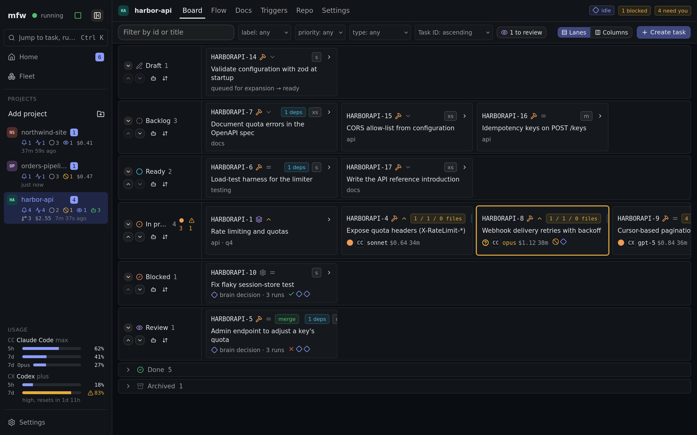
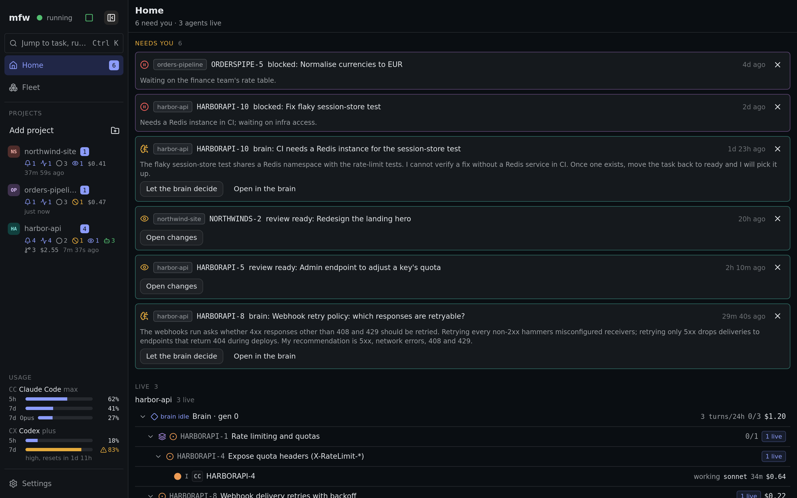
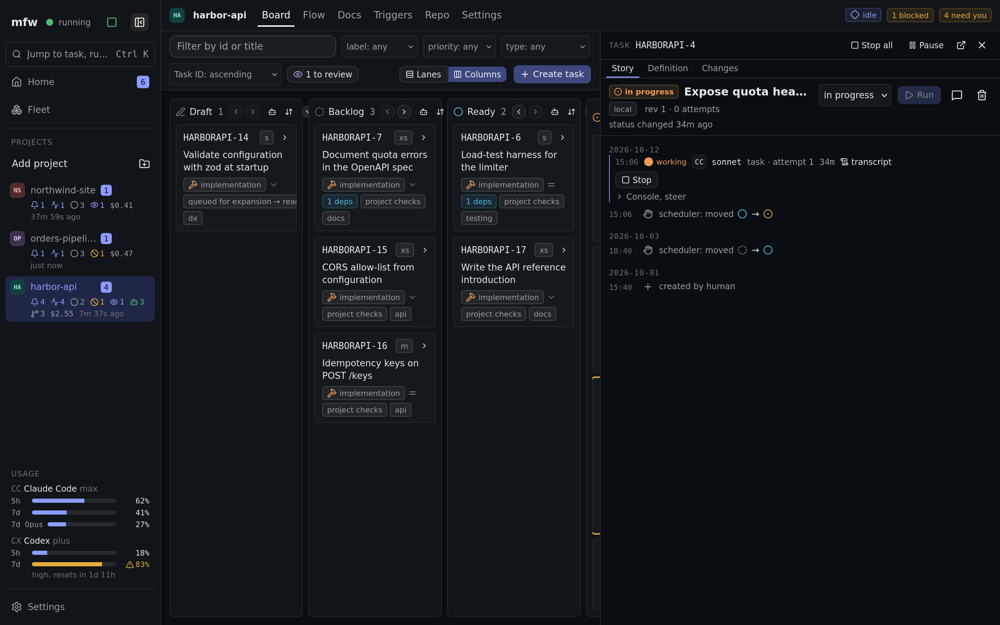
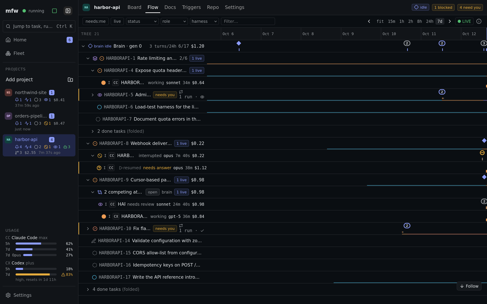
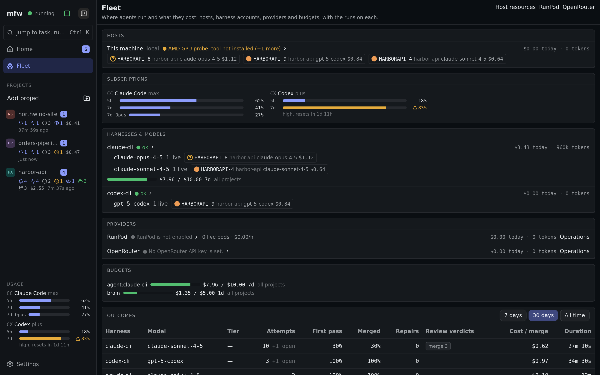
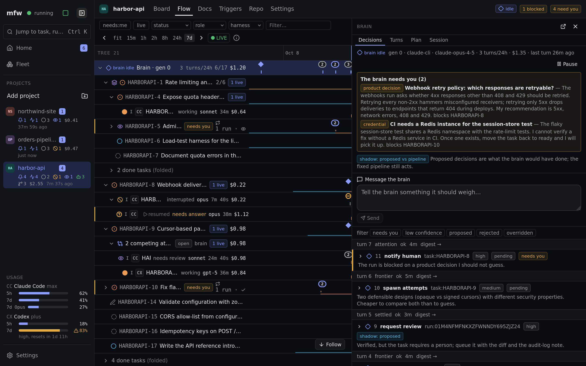
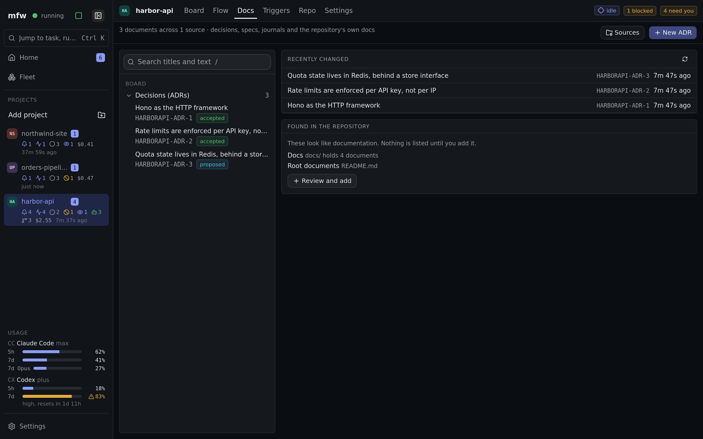
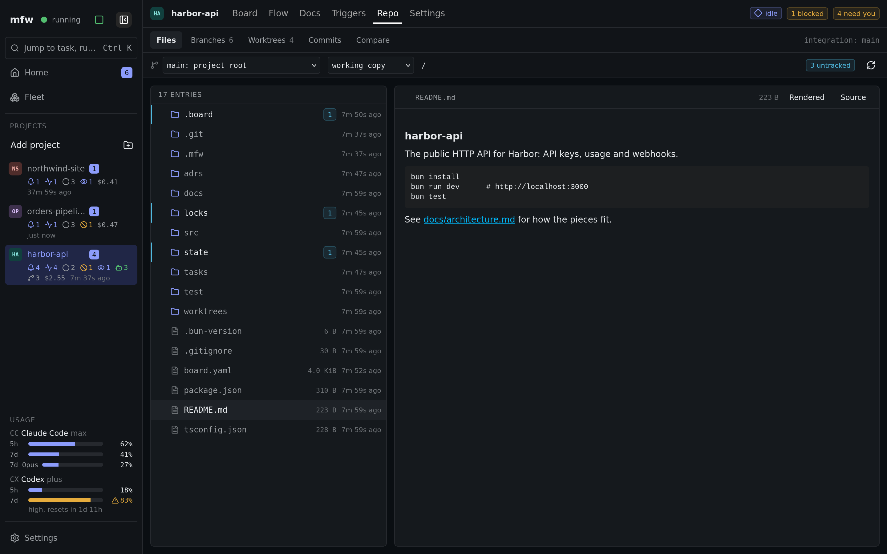
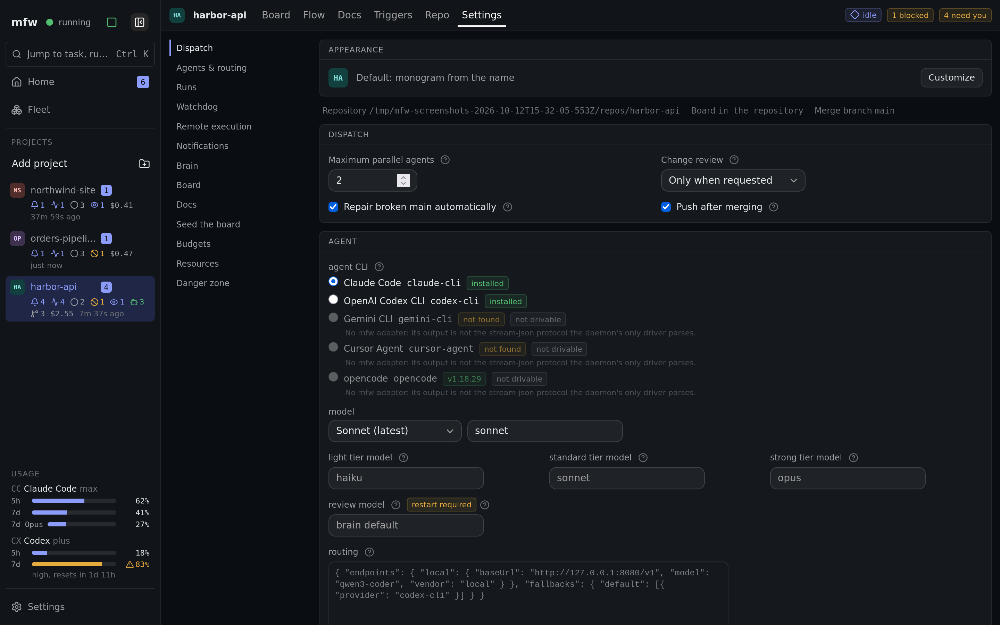

# mfw

**mfw lets AI coding agents work through your project's to-do list while you stay
in control.** You describe the work as tasks. mfw decides what can start, hands
each task to an agent, checks the result, and merges it only if it passes.

mfw is three things that fit together. You can use the first on its own.

| Part | What it is | Use it to |
| --- | --- | --- |
| [**Board tool**](#1-the-board-tool-mfwb) (`mfwb`) | A command-line tool for a folder of task files | Keep and query a project's tasks and decisions, see what is ready to work on, plan work that can run in parallel |
| [**Daemon**](#2-the-daemon) | A background engine | Run agents on ready tasks automatically, verify their work and merge it |
| [**Web UI**](#3-the-web-ui) | A website served from your machine | Watch and steer everything: the board, running agents, reviews |

```
  you ──► Web UI ──► Daemon ──► agents (Claude Code, Codex) working in git
              │         │
              └─────────┴──► Board: plain task files in a folder  ◄── mfwb (CLI)
```



More screenshots [below, in the web UI section](#3-the-web-ui).

## 1. The board tool (`mfwb`)

A **board** is a folder of plain text files (markdown): one file per task, plus
files for specs and design decisions. There is no database to keep in sync, and
the files live in git like the rest of your project. `mfwb` is the tool for
working with them from the terminal. It needs no server and works on its own.

What you can do with it:

- **Create and update tasks**, with typed fields, checklists and notes. Edits are
  safe when several people or agents change the same file at once.
- **See what is ready:** tasks whose dependencies are all finished.
- **Plan parallel work:** `mfwb plan` picks a batch of ready tasks that will not
  step on each other's files. `mfwb graph` draws the dependency graph.
- **Move tasks along** with the steps your board defines (`start`, `done`, ...),
  optionally committing just that task's file.
- **Validate** the whole board: broken links, duplicate ids, dependency cycles.

```sh
mfwb list status=planned           # find tasks
mfwb ready                         # what can start now
mfwb plan --max 4                  # a batch that will not collide
mfwb start ABC-12                  # begin a task
mfwb done ABC-12 "landed"          # finish it
```

How a board looks (which fields exist, how ids are numbered, which steps are
allowed) is defined in one `board.yaml` file, so the same tool fits very
different projects. Every command is explained in
[packages/board/README.md](packages/board/README.md). `mfwb skill install` also
teaches your coding agents (Claude Code, Codex, opencode, pi) how to use it.

## 2. The daemon

The daemon is the engine that does the work. For each project you attach, it:

- **Picks ready tasks** in dependency order, and runs several at once.
- **Gives each task its own copy of the repository** (a git worktree on its own
  branch), so agents never overwrite each other.
- **Runs a coding agent** (Claude Code or OpenAI Codex CLI) on the task. Each agent
  runs in its own terminal session that survives restarts of the daemon, and you
  can steer or stop it while it works.
- **Checks the result** against the task's goal and acceptance criteria, then runs
  the checks in a clean copy of the repository. It never takes the agent's word.
- **Merges automatically** when everything passes, into a branch you choose. If the
  main branch turns red, it stops merging and can repair it.
- **Asks a model for help only when needed:** to diagnose an ambiguous failure,
  resolve a stubborn conflict, or review a change. Scheduling, checking and
  merging are always mechanical.
- **Handles recurring work and reactions:** tasks that repeat on a schedule or
  event, and triggers such as "deploy after a merge lands".
- **Can use a rented GPU machine (RunPod)** for tasks that need one.

Safe by default: the scheduler is **off** until you turn it on, so starting mfw
never starts spending. Agents run with your user's permissions, so only attach
projects you are happy to let them work on.

## 3. The web UI

The web UI runs on your machine and shows:

- the **board** as columns of tasks, with each task's detail, history and files;
- **running agents**, live: a readable view and the raw output, with buttons to
  steer or stop an agent mid-task;
- the **review queue** for work waiting on a human, and an **inbox** of things that
  need your attention;
- **docs**: the project's decisions, specs and journals from the board, plus any
  documentation directories you add (or accept from the suggestions), with
  search, rendered Mermaid diagrams and SVG/PNG images, read-only for plain files;
- **runs**, **resources** and **triggers**, and per-project **settings** such as the
  scheduler switch and how much help the model may give;
- a layout that works on a phone as well as a desktop.

| | |
| --- | --- |
| <a href="docs/screenshots/home-dark-1440x900.png"></a><br>Home: what needs you, and agents live across projects | <a href="docs/screenshots/board-inspector-dark-1440x900.png"></a><br>A task open in the inspector next to the board |
| <a href="docs/screenshots/flow-dark-1440x900.png"></a><br>Flow: the task tree and run timeline, brain on top | <a href="docs/screenshots/fleet-dark-1440x900.png"></a><br>Fleet: hosts, subscriptions, harnesses and budgets |
| <a href="docs/screenshots/brain-dark-1440x900.png"></a><br>The brain: its decisions, plan and budget | <a href="docs/screenshots/docs-dark-1440x900.png"></a><br>Docs: decisions, specs and journals |
| <a href="docs/screenshots/repo-dark-1440x900.png"></a><br>Repo: files with the README rendered, branches, commits | <a href="docs/screenshots/settings-dark-1440x900.png"></a><br>Project settings |

### For agents: the MCP server

`@mfw/mcp` lets a coding agent read and edit your tasks through the running app,
so there is still only one source of truth. Add it to any MCP-capable agent:

```json
{ "mcpServers": { "mfw": { "command": "bun", "args": ["run", "packages/mcp/src/main.ts"] } } }
```

It offers tools to list and read tasks, see the dependency graph, create, edit
and move tasks, check the inbox and health, and look at runs.

## Getting started

You need [Bun](https://bun.sh), [git](https://git-scm.com) and
[tmux](https://github.com/tmux/tmux), plus the agent CLIs you want to use
(Claude Code and/or Codex).

```sh
bun install
bun run build          # build the app
bun run start          # run it
```

Open **http://localhost:7777/mfw/**, add a project, and create a few tasks. Nothing
runs until you switch the scheduler on in the UI. The on/off choice is remembered
across restarts.

To use only the board tool, you do not need any of that:

```sh
bun packages/board/src/cli.ts --help
```

### Reach it from your phone

Keep the server on loopback and let Tailscale publish it with a real certificate:

```sh
tailscale serve --bg --set-path /mfw http://127.0.0.1:7777/mfw
```

Open `https://<machine>.<tailnet>.ts.net/mfw` from any device on your tailnet. The
`/mfw` in the target is deliberate: the app is built to live under that prefix, and
without it every asset 404s.

To reach it without a proxy, set `HOST` to the machine's Tailscale IPv4 address (for
example `HOST="$(tailscale ip -4 | head -n1)"`) and open `http://<machine>:7777/mfw`.
It is plain HTTP, but the tailnet encrypts it. Never set `HOST=0.0.0.0`: agents run
with your permissions, so the listener must not be reachable from the LAN.

### Run it as a service

- **systemd (user):** copy [`packaging/mfw.service`](./packaging/mfw.service) to
  `~/.config/systemd/user/`, then `systemctl --user enable --now mfw`.
- **NixOS / home-manager:** import
  [`packaging/mfw.home-manager.nix`](./packaging/mfw.home-manager.nix).

Both keep the scheduler off until you enable it in the UI.

### Settings

| Variable | Default | What it does |
| --- | --- | --- |
| `MFW_HOME` | `~/.local/share/mfw` | where mfw keeps its settings, database and run records |
| `PORT` / `HOST` | `7777` / runtime default | the address the server listens on |
| `MFW_BASE_PATH` | `/mfw/` | the URL prefix, fixed when you run `bun run build` (`/` for the root) |
| `MFW_URL` | `http://localhost:7777/mfw/api/trpc` | where the MCP server finds the app |

Provider keys, if you use any, are stored in a private file
(`~/.local/share/mfw/credentials.json`, readable only by you), never in the
database. mfw never edits your `.gitignore`.

### Acceptance criteria on older boards

Acceptance criteria are the task type's `acceptance` checklist field. When mfw
attaches a board created before that field existed, it adds the field to
`board.yaml` and moves each task's `## Acceptance Criteria` list into it, in one
board commit. To hand the board back to an older mfw, stop the daemon and run:

```sh
bun run tools/board-acceptance.ts --revert /absolute/project/root
```

### Advanced: automatic reopen conditions

A parked task can declare `reopen_when` conditions. `task_done` predicates are
checked automatically. Command predicates are inert until an operator arms the
exact conditions outside the repository:

```sh
bun run tools/reopen-policy.ts arm /absolute/project/root MFW-42
bun run tools/reopen-policy.ts disarm /absolute/project/root MFW-42
```

Arming uses the attached project's operator configuration and pins the conditions,
check prefix and integration branch in `$MFW_HOME/reopen/` (default
`~/.local/share/mfw/reopen/`). Editing them requires rearming. Commands run only
while dispatch is enabled, at most once every ten minutes across restarts. Every
attempt has durable start and result events in the project audit log.

The default checkout is a fresh detached worktree of the integration branch;
install any dependencies needed by the check there. A probe intentionally inspecting
the primary checkout must opt in with a final `primary` argument to `arm`.
A worktree isolates ordinary checkout writes, but is not a shell security sandbox.
Automatic reopening rechecks task conditions, dependencies, the specification and
required template sections before moving the task to ready.

## How it is built

The architecture notes live in the backstage knowledge repository under
`projects/mfw/architecture.md`. The short version: one app (a [TanStack Start](https://tanstack.com/start) server) runs the
daemon in-process, serves the web UI and a typed API, and keeps run bookkeeping in
a local SQLite database. The board itself is always just files.

```
packages/
  board-core/  the board engine (library): documents, locks, validation, workflow
  board/       mfwb, the board CLI, and the agent skill
  core/        shared types and task-graph logic
  db/          database schema and event log
  daemon/      the daemon: scheduler, agent runs, verification, merging
  api/         the typed API between the UI and the daemon
  mcp/         the MCP server for agents
apps/
  start/       the app: web UI + API, boots the daemon
packaging/     systemd and NixOS service files
tools/         small operator scripts
```

## Develop

Use [Nix](https://nixos.org) (flakes) with [direnv](https://direnv.net), or Bun and
tmux directly.

```sh
direnv allow           # enters the dev shell (bun, node, sqlite, git)
bun install
bun run lint           # biome + typecheck
bun run test           # all test suites
bun run dev            # the app with hot reload
```

Each agent runs in a detached tmux session with its output on disk under
`<project>/.mfw/runs/<id>/`, so runs survive daemon restarts and are picked up
again on boot.

## License

[MIT](./LICENSE)
